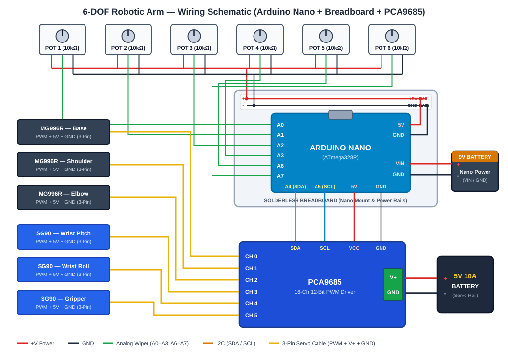

# 6dof-potentiometer-robotic-arm
Firmware, wiring schematic, and BOM for a 6-DOF desktop robotic arm controlled in real time using six 10 kΩ potentiometers, an Arduino Nano, and a PCA9685 16-channel PWM servo driver.
## Mechanical Design Credit
The 3D-printed frame was built using the **6-DOF Robotic Arm STL files designed by OmArTronics**. Because these 3D model files are distributed under a personal-use license, they are not redistributed in this repository—you can get the STL package directly from the [OmArTronics Store](https://omartronics.com/product/6-dof-robotic-arm-diy-guide/).

---

## Bill of Materials (BOM)

| Qty | Component | Specification / Role |
| :--- | :--- | :--- |
| 1 | **Arduino Nano** | ATmega328P microcontroller; reads 10-bit analog inputs and transmits I2C commands |
| 1 | **PCA9685 PWM Driver** | 16-channel, 12-bit I2C servo controller (`0x40`) running at 60 Hz |
| 1 | **Breadboard** | Mounts the Arduino Nano and distributes `5V` and `GND` rails to the potentiometers |
| 3 | **MG996R Servos** | High-torque metal-gear servos for Base, Shoulder, and Elbow |
| 3 | **SG90 Micro Servos** | Lightweight micro servos for Wrist Pitch, Wrist Roll, and Gripper |
| 6 | **10 kΩ Potentiometers** | Linear rotary potentiometers acting as analog joint controllers |
| 1 | **9V Battery** | Dedicated logic power supply for the Arduino Nano (`VIN` / `GND`) |
| 1 | **5V 10A Battery Pack** | Dedicated high-current external power supply for the servo rail |

---

## Wiring & Pinout

### Power, Breadboard & I2C Connections
* **9V Battery `+`** → Arduino Nano `VIN` (Microcontroller logic supply)
* **9V Battery `-`** → Arduino Nano `GND`
* **Arduino Nano `5V` & `GND`** → Breadboard `+5V` and `GND` power rails (feeds all 6 potentiometers)
* **Arduino Nano `5V`** → PCA9685 `VCC` (Driver logic power)
* **Arduino Nano `GND`** → PCA9685 `GND` (Common logic ground)
* **Arduino Nano `A4` (`SDA`)** → PCA9685 `SDA` (I2C data)
* **Arduino Nano `A5` (`SCL`)** → PCA9685 `SCL` (I2C clock)
* **5V 10A Battery `+`** → PCA9685 `V+` screw terminal (Servo motor power rail)
* **5V 10A Battery `-`** → PCA9685 `GND` screw terminal (Common ground shared with Nano)

> **Power Isolation:** The Arduino Nano is mounted on the breadboard and powered independently by the 9V battery via its onboard voltage regulator (`VIN`), while all six servos draw current exclusively from the external 5V 10A battery through the PCA9685 `V+` rail—preventing brownouts and microcontroller resets under load.

### Joint, Potentiometer & Channel Mapping

| Joint | Actuator | PCA9685 Channel | Nano Analog Pin | Notes |
| :--- | :--- | :--- | :--- | :--- |
| **Base** | MG996R | Channel 0 | `A0` | High-torque base rotation |
| **Shoulder** | MG996R | Channel 1 | `A1` | Primary arm lift |
| **Elbow** | MG996R | Channel 2 | `A2` | Forearm articulation |
| **Wrist Pitch** | SG90 | Channel 3 | `A3` | End-effector tilt |
| **Wrist Roll** | SG90 | Channel 4 | `A6` | Uses `A6` since `A4` is reserved for I2C `SDA` |
| **Gripper** | SG90 | Channel 5 | `A7` | Uses `A7` since `A5` is reserved for I2C `SCL` |

*(Each potentiometer's outer terminals connect across the breadboard's `+5V` and `GND` rails, with the middle wiper terminal wired to its corresponding analog input on the Nano.)*

---

## Firmware Overview

* **Library Dependency:** `Adafruit PWM Servo Driver Library` (`Adafruit_PWMServoDriver.h`) and standard Arduino `Wire.h`.
* **PWM Configuration:** Configured at **60 Hz** (`pwm.setPWMFreq(60)`) with 12-bit resolution (4096 ticks per period).
* **Control Mapping:** Reads 10-bit ADC values (`0–1023`) across `A0–A3`, `A6`, and `A7`, maps them to a **`125–575`** PWM pulse-tick range, and updates all six PCA9685 channels every `20 ms` (`~50 Hz` loop rate).
